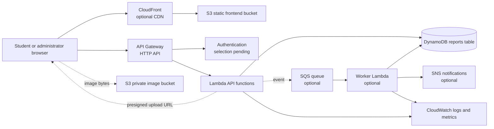

# Planned Architecture

This document describes a proposed architecture only. It has not been deployed or tested in AWS.

## High-level diagram

## Service evaluation

| Service | Proposed responsibility | MVP decision |
|---|---|---|
| S3 | Host static assets and store private item images in separate prefixes/buckets. | Suitable; keep buckets private and review storage/requests. |
| CloudFront | Cache and serve the static frontend over HTTPS. | Useful for a deployed frontend, but defer if direct/local hosting is sufficient. |
| API Gateway | Expose a small HTTPS API to the browser. | Suitable for the serverless path; verify Learner Lab access later. |
| Lambda | Validate requests, enforce authorization, read/write DynamoDB, issue upload URLs. | Core backend choice; keep functions small. |
| DynamoDB | Store reports and the minimum metadata needed for access patterns. | Core database choice. |
| SQS | Buffer asynchronous matching/notification jobs and absorb retries. | Optional; defer until asynchronous work is justified. |
| SNS | Fan out notifications to supported subscribers. | Optional; defer because notification channels add complexity and possible cost. |
| IAM | Least-privilege permissions for humans, functions, and deployment roles. | Required control, not a user-facing feature. |
| CloudWatch | Logs, metrics, alarms, and troubleshooting. | Required baseline monitoring; avoid noisy logs and expensive retention. |
| KMS | Customer-managed encryption keys where needed. | Optional for MVP; use service-managed encryption by default unless requirements justify KMS key cost/permissions. |

## Request and image flows

1. The browser downloads static assets from S3 directly or through CloudFront.
2. The browser sends authenticated API requests to API Gateway.
3. Lambda validates the request and reads/writes the DynamoDB report table.
4. For an image, Lambda validates metadata and returns a short-lived presigned S3 upload URL. The browser uploads bytes directly to the private image bucket. The report stores only a safe object key/reference.
5. Report detail responses return a short-lived read URL only when the requester is authorized.

This avoids routing image bytes through Lambda and reduces function memory, execution time, and API payload complexity. Upload limits, content type allowlists, object-key ownership checks, and malware/content review remain implementation concerns.

## Optional asynchronous flow

After a report is created, Lambda could enqueue a small job in SQS. A worker Lambda would calculate transparent candidate matches and persist them, then optionally publish a notification through SNS. SQS is most useful when matching becomes slow, retryable, or independent from the user's request. For a small MVP, synchronous matching or an administrator-triggered job may be simpler and cheaper.

## Deferred components

CloudFront, SQS, SNS, KMS customer-managed keys, and automated notifications can all be deferred. The minimum deployable AWS shape is S3, API Gateway, Lambda, DynamoDB, IAM, and CloudWatch, subject to Learner Lab permissions. Local development should use mock storage, mock API handlers, and a local/in-memory data adapter before any deployment.

## Key risks

- Learner Lab may restrict service creation, regions, IAM actions, or quotas.
- Authentication is a design dependency and must not be improvised with insecure client-side tokens.
- DynamoDB scans, oversized images, verbose logs, and forgotten buckets can increase cost.
- CDN, API, notifications, and managed keys add useful capability but also increase configuration and operational surface area.

